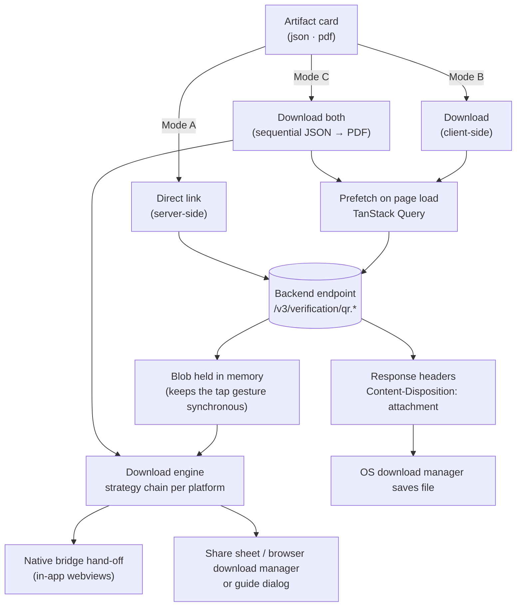
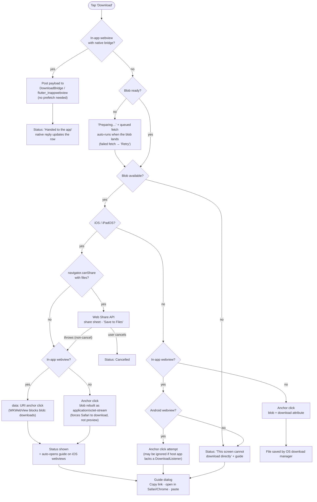
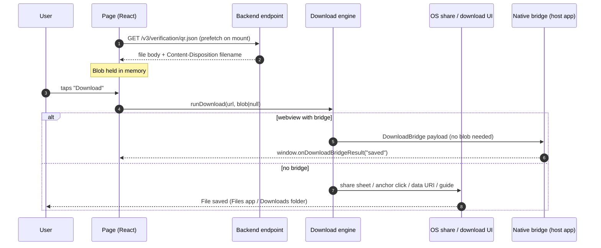
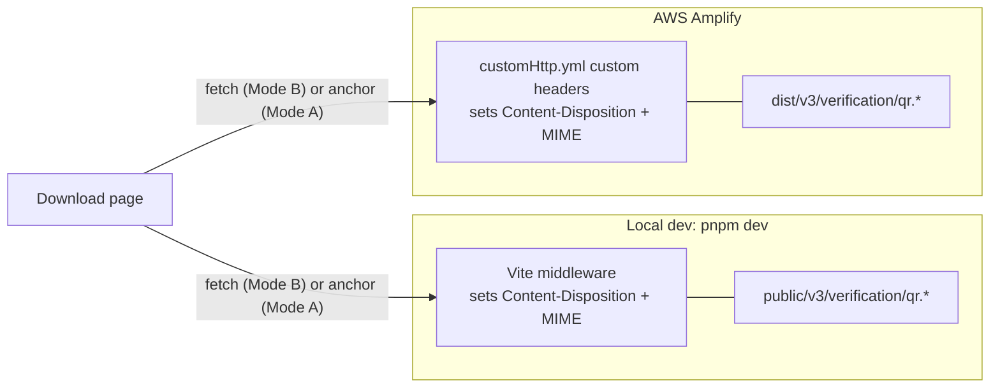

# Download Flow (Visual)

How the download page moves a file from the backend endpoint to a device — across iOS, iPadOS, Android, desktop, and in-app webviews. Two documents are offered: JSON and PDF.

## 1. System Overview



- **Mode B — Download:** the backend returns the file body (e.g. JSON). The frontend fetches it ahead of time, then applies a per-platform strategy so the file actually saves.
- **Mode A — Direct link:** a plain link to the endpoint. The server's `Content-Disposition: attachment` header does the work — the most reliable path on iOS.
- **Mode C — Download both:** runs the same strategy chain for JSON then PDF, sequentially, and aggregates a status message. iOS may only grant one share sheet per gesture — the per-row buttons remain the fallback.

## 2. Strategy Chain (Download)

Mirrors `src/features/download-file/model/engine.ts` exactly. The bridge path needs no blob at all; every other path needs the blob to be ready before the tap is served (Safari drops user activation otherwise).



## 3. Sequence: Download



"Download both" repeats the second half of this sequence for each artifact (JSON, then PDF) and aggregates the outcome into a single status line. On iOS the second share sheet may be denied once the tap gesture's activation is spent — the engine then falls back to the octet-stream attempt, and any file counted as not handled is left for the per-row buttons.

## 4. Bridge Contract (In-App Webviews)

In-app webviews cannot save downloads from JS alone — no web-only change fixes that. When the page detects a host-app bridge, the engine hands the file over to native code instead of faking a download.

### Detection & transport (web side: `model/bridge.ts`)

Either channel works, checked in this order:

| Channel | Injected by | Call |
| :--- | :--- | :--- |
| `window.DownloadBridge.postMessage(json)` | `webview_flutter` JavaScript channel | host receives the JSON string |
| `window.flutter_inappwebview.callHandler('downloadBridge', payload)` | `flutter_inappwebview` | host receives the payload object; its return value is used as the result |

Payload:

```json
{
  "type": "download",
  "version": 1,
  "url": "/v3/verification/qr.json",
  "filename": "verification-qr.json",
  "mimeType": "application/json"
}
```

### Host app responsibilities

1. Receive the payload and download the file natively (or copy it from bundled assets).
2. Save it to the device (Files / Documents / Downloads) using native APIs.
3. Report the result — either by evaluating JS in the page:

```js
window.onDownloadBridgeResult(JSON.stringify({ status: 'saved', filename: 'verification-qr.json' }))
```

`status` is `saved` | `failed` | `cancelled`. The page matches `filename` to the artifact row and updates its status line. Outcomes without a `filename` update every row whose last action was a bridge hand-off.

### Integration notes

- `payload.url` is relative to the page origin (or absolute when `VITE_API_BASE_URL` is set on the web build) — resolve it against the webview's current URL before downloading.
- The page installs `window.onDownloadBridgeResult` itself, only if no handler is defined yet. Don't pre-define it from host code before the page loads, or the page's status lines will never receive results.
- The bridge payload carries no auth beyond the page's own session — register the bridge only for trusted origins.

### Flutter snippets

`webview_flutter` (channel + evaluated callback):

```dart
controller.addJavaScriptChannel(
  'DownloadBridge',
  onMessageReceived: (message) async {
    final payload = jsonDecode(message.message) as Map<String, dynamic>;
    final saved = await saveDownloadToDevice(payload);
    final result = jsonEncode({
      'status': saved ? 'saved' : 'failed',
      'filename': payload['filename'],
    });
    await controller.runJavaScript(
      "window.onDownloadBridgeResult('$result')",
    );
  },
);
```

`flutter_inappwebview` (handler; the returned JSON string becomes the result):

```dart
controller.addJavaScriptHandler(
  handlerName: 'downloadBridge',
  callback: (args) async {
    final payload = (args.first as Map).cast<String, dynamic>();
    final saved = await saveDownloadToDevice(payload);
    return jsonEncode({
      'status': saved ? 'saved' : 'failed',
      'filename': payload['filename'],
    });
  },
);
```

Without a bridge, the page still works: it falls back to the data-URI/blob attempts and auto-opens the manual guide on iOS webviews.

## 5. Sequence: Direct Link

```mermaid
sequenceDiagram
    autonumber
    participant U as User
    participant B as Browser
    participant E as Backend endpoint
    participant D as OS download manager

    U->>B: taps "Direct link" (plain anchor navigation)
    B->>E: GET /v3/verification/qr.json
    E-->>B: 200 OK
    Note right of E: Content-Type: application/json<br/>Content-Disposition: attachment; filename="verification-qr.json"
    B->>D: attachment header forces save on all platforms (incl. iOS Safari)
    D-->>U: File in Files app / Downloads folder
```

## 6. Backend Simulation: Dev vs Prod

Same headers, two hosting paths — so local phone testing matches production behavior.



## 7. Platform Matrix

| Platform | Mode B (Download) | Mode A (Direct link) |
| :--- | :--- | :--- |
| iOS / iPadOS Safari | Web Share &#8594; octet-stream blob | `Content-Disposition` header &#10003; |
| iOS in-app webview (Instagram, Facebook, ...) | bridge if present &#8594; data URI anchor &#8594; auto guide | Often blocked &#8594; guide |
| Flutter webview with bridge | native hand-off + result callback | host-app dependent |
| Android browser | blob + `download` attribute | header &#10003; |
| Android webview | bridge if present &#8594; blob attempt &#8594; guide | host-app dependent |
| Desktop (all browsers) | blob + `download` attribute | header &#10003; |

## 8. Why This Is Needed (iOS WebKit Quirks)

- All iOS browsers use WebKit — Chrome/Firefox/Edge on iPhone behave like Safari, not like their desktop versions.
- Text-like files (JSON) open in-tab instead of downloading; PDFs get previewed.
- `blob:` URLs with the `download` attribute are ignored inside WKWebView (in-app browsers).
- `data:` URIs still work in WKWebView but broke in recent iOS Safari — hence blob for Safari, data URI for webviews.
- Rebuilding a blob as `application/octet-stream` forces Safari to download instead of preview.
- Filenames are lost unless the server sends `Content-Disposition` or the user goes through the share sheet.
- In-app browsers (Instagram, Facebook) often block downloads entirely — no web code fixes that; the guide dialog is the fallback.
- Never pass `title` (or `text`) alongside `files` in `navigator.share` on iOS — the share sheet treats them as extra items, so "Save to Files" writes the file plus an extra `.txt` containing the title text. The filename always comes from `File.name`.
- Inside a host app's own webview (e.g. Flutter), the only real fix is a native bridge — see section 4. The page detects the bridge automatically and hands off.

## 9. Source Map

| Concern | File |
| :--- | :--- |
| Platform / webview detection | `src/shared/lib/platform.ts` |
| Strategy chain (pure logic) | `src/features/download-file/model/engine.ts` |
| Native bridge detection, post, result parsing | `src/features/download-file/model/bridge.ts` |
| Real DOM implementations (share, anchor, data URI) | `src/features/download-file/model/browser.ts` |
| Gesture-safe orchestration hook | `src/features/download-file/model/useDownloadFile.ts` |
| Bulk download orchestration (Mode C) | `src/features/download-file/model/useDownloadAll.ts` |
| Guide dialog content per platform | `src/features/download-file/model/guide.ts` |
| Copy-link clipboard helper | `src/shared/lib/clipboard.ts` |
| Fetch + Content-Disposition parsing | `src/shared/api/client.ts` |
| Artifact catalog (endpoints) | `src/entities/download-artifact/model/catalog.ts` |
| Simulated backend headers (dev) | `vite.config.ts` |
| Simulated backend headers (prod) | `customHttp.yml` |

Append `?simulate=ios`, `?simulate=ipados`, `?simulate=android`, `?simulate=ios-webview`, `?simulate=android-webview`, `?simulate=instagram`, or `?simulate=facebook` to preview any strategy from a desktop browser.
